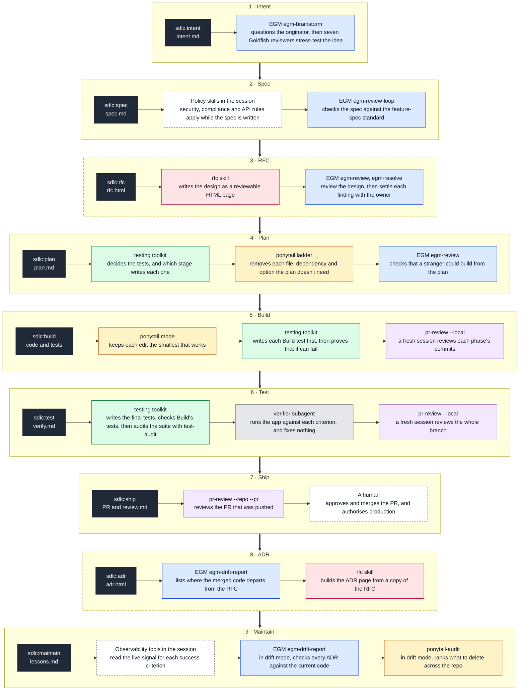
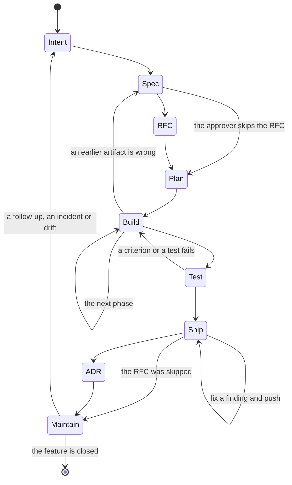
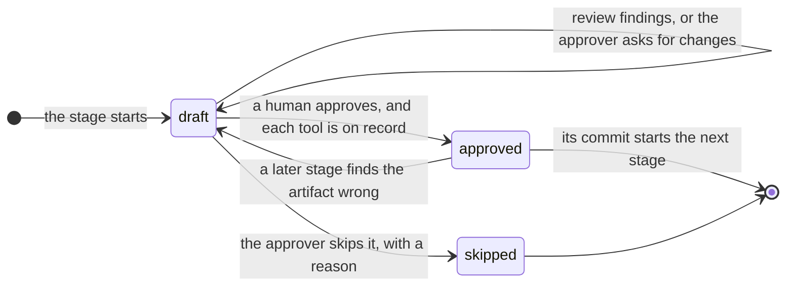
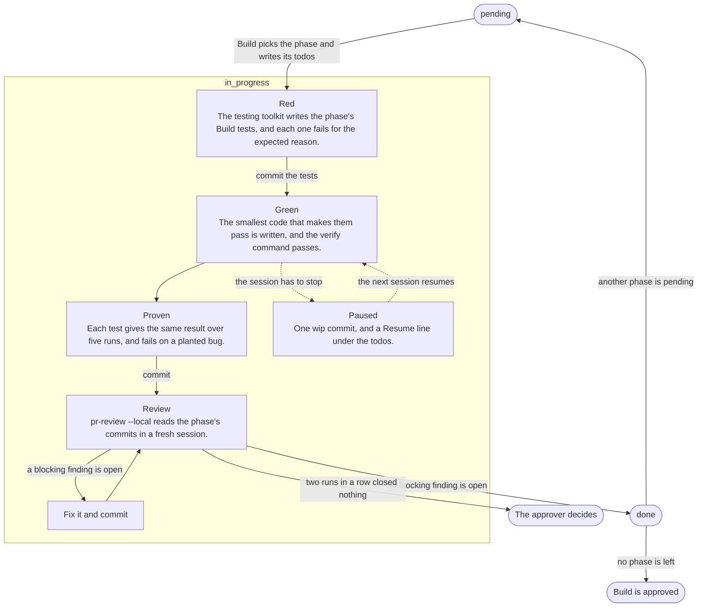
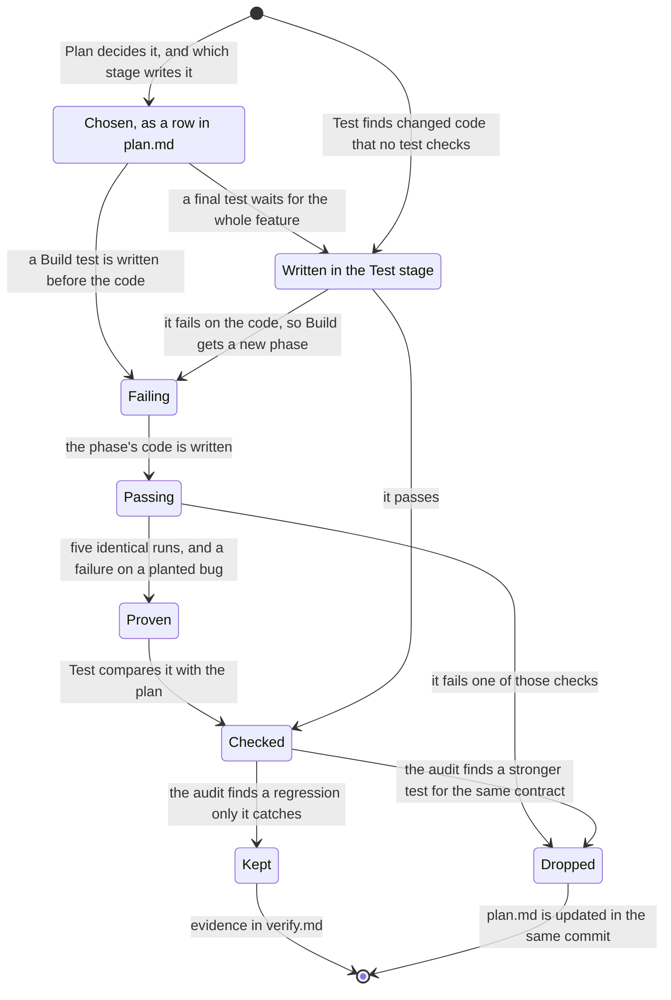
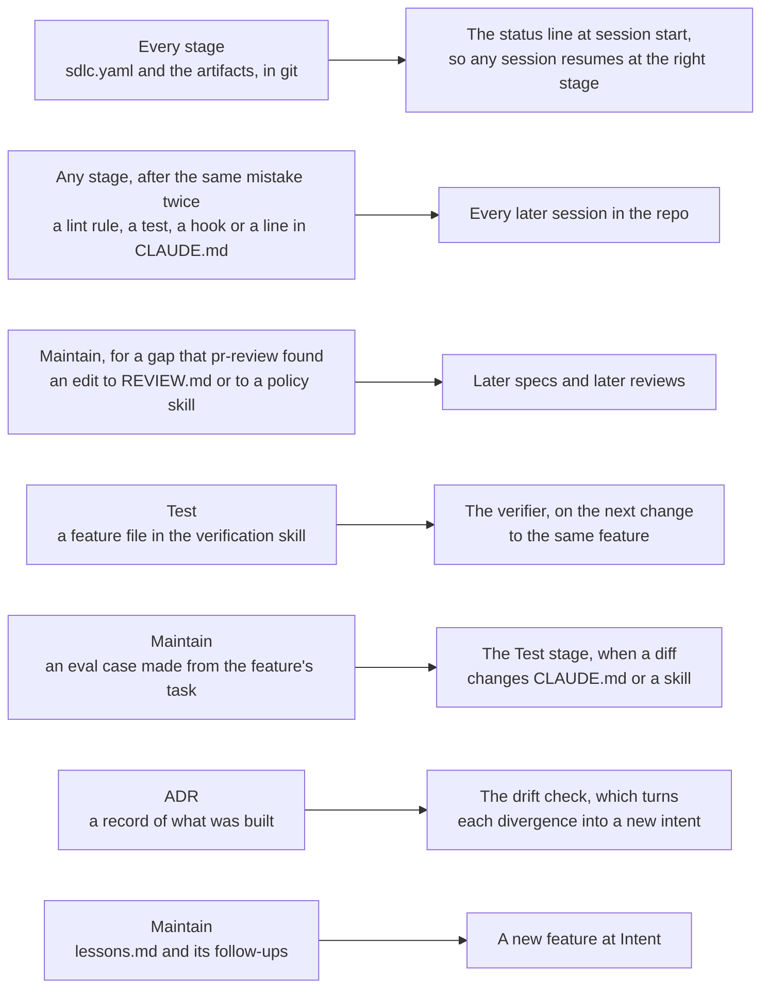
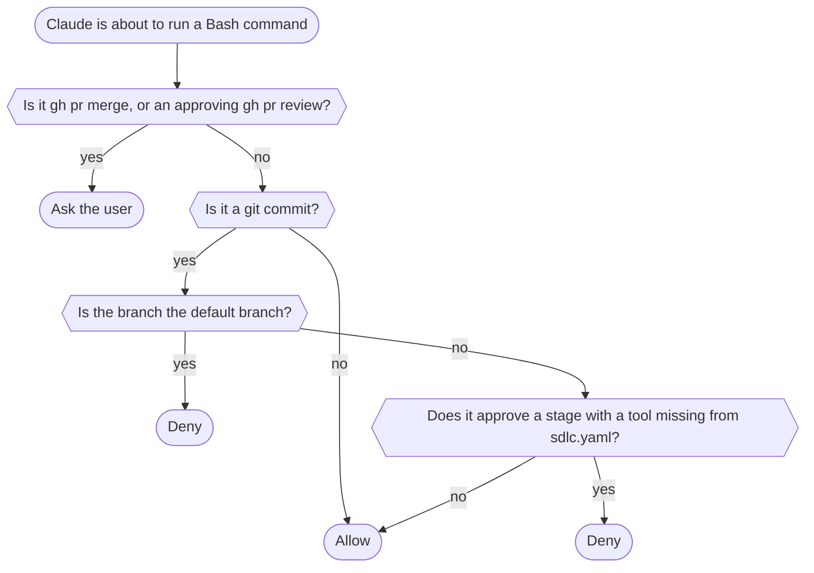

# sdlc-toolkit

A Claude Code plugin that runs a feature through the loop in Anthropic's [AI-Native SDLC Playbook](https://claude.com/resources/articles/the-ai-native-sdlc-playbook). Each stage ends by committing one artifact under `docs/sdlc/<slug>/` in the target repo, and that commit starts the next stage. Agents with fresh context review every artifact: [EGM](https://github.com/google/elephant-goldfish-model) Goldfish reviewers check the documents, and [pr-review](https://github.com/aasimsani/pr-review) checks the code. The [testing toolkit](https://github.com/aasimsani/testing-toolkit) decides the tests in Plan, writes the ones that drive the code in Build, and writes the final ones, checks them all and audits the suite in Test.

```
intent → spec → RFC → plan → build → test → ship → ADR → maintain
  ↑                                                         │
  └────────── follow-ups and incidents become new intents ──┘
```

| # | Stage | Artifact | Fresh-context review |
|---|---|---|---|
| 1 | Intent | `intent.md` | `egm-brainstorm` (seven Goldfish lenses) |
| 2 | Spec | `spec.md` | `egm-review-loop` with the feature-spec standard |
| 3 | RFC | `rfc.src.html` + `rfc.html` from the `rfc` skill, or `rfc.md` from `egm-draft` | `egm-review`, then `egm-resolve` |
| 4 | Plan | `plan.md`, with the tests the testing toolkit chose | `egm-review` implementation-readiness stage |
| 5 | Build | code + tests, each test written before the code it tests | Ponytail mode while coding, then `pr-review --local` with the ponytail lens after each phase |
| 6 | Test | `verify.md` | The testing toolkit's final tests, check and audit, the `verifier` subagent + final `pr-review --local` with the ponytail lens |
| 7 | Ship | PR + `review.md` | `pr-review --repo --pr`, then a human approves and merges |
| 8 | ADR | `adr.src.html` + `adr.html`, a copy of the RFC updated to what shipped | `egm-drift-report` |
| 9 | Maintain | `lessons.md` | `egm-drift-report`, `ponytail-audit` + live signals |

`docs/sdlc/<slug>/sdlc.yaml` records each stage's status, owner and approver, and the tools the stage ran or skipped. A human approves every artifact. Claude never approves its own work, merges a PR, or deploys to production.

## Install

```bash
claude plugin marketplace add aasimsani/sdlc-toolkit
claude plugin install sdlc@sdlc-toolkit
```

Then run `/sdlc:setup` in a repo. It installs EGM, pr-review, [ponytail](https://github.com/DietrichGebert/ponytail) and the testing toolkit if they're missing. It also makes sure `CLAUDE.md` names one verify command and that `REVIEW.md` exists. It offers a verification skill for the app and the gate hook.

## Use

| Command | What it does |
|---|---|
| `/sdlc:sdlc` | Shows a status board of every feature in flight, with who it's waiting on. |
| `/sdlc:sdlc <idea or slug>` | Starts a feature, or runs the next stage of an existing one. |
| `/sdlc:<stage> <slug>` | Runs one stage: `intent`, `spec`, `rfc`, `plan`, `build`, `test`, `ship`, `adr` or `maintain`. |
| `… --adopt <path\|url>` | Brings in an artifact someone wrote elsewhere, such as a file, Notion page, Google Doc or Linear doc, then runs its review and gate. |
| `… --review` | Runs as the stage's manager. Claude reviews someone else's artifact and records your decision without editing it. |
| `/sdlc:maintain drift` | Checks every ADR against the current code, and audits the repo for over-engineering with `ponytail-audit`. |

## The loop in diagrams

The loop has four explicit state machines, and each one keeps its state in a file or a script: the stage a feature is at (`sdlc.yaml`), one stage's status (`sdlc.yaml`), one phase's status (`plan.md`) and the gate hook's decision (`sdlc-gate.sh`). It also has two implicit ones that no file names: the life of one test across Plan, Build and Test, and the files that one feature leaves for the next. The hook's decision is drawn under [Gate hook](#gate-hook).

### Who helps at each stage

Each row is one stage. The dark box is the stage's skill and its artifact, and the boxes after it are the helpers it calls, in the order it calls them. The approver can skip the two stages with a dashed border.



| Colour | Helper | What it adds |
|---|---|---|
| 🟦 | [EGM](https://github.com/google/elephant-goldfish-model) | Goldfish reviewers read each document with no memory of the conversation that produced it |
| 🟥 | The `rfc` skill | Writes the RFC, and later the ADR, as an HTML page a reviewer can read |
| 🟩 | [Testing toolkit](https://github.com/aasimsani/testing-toolkit) | Decides the tests in Plan, writes the Build tests before the code, and in Test writes the final tests, checks them all and audits the suite |
| 🟨 | [ponytail](https://github.com/DietrichGebert/ponytail) | Keeps the plan and the code as small as they can be |
| 🟪 | [pr-review](https://github.com/aasimsani/pr-review) | Reviews code in a fresh session that has none of the build session's context |
| ⬜ | This plugin, or whatever the session has | The `verifier` subagent is this plugin's own. Policy skills and observability tools come from the session. |

Every stage ends at the same gate, where a human approves the artifact. Superpowers and agent-skills aren't in the diagram, because the loop doesn't call them. [`references/companions.md`](plugins/sdlc/references/companions.md) says which of their skills help with one step.

### Paths between stages

A feature's stage is the first one in `sdlc.yaml` that isn't approved or skipped. An arrow with no label is an approval.



- The approver may skip a stage that adds nothing, and `sdlc.yaml` records the reason. A skipped RFC skips the ADR too. Build, Test and Ship are never skipped.
- Build runs one phase of `plan.md` at a time, and it's approved when every phase is done.
- Test sends the feature back to Build as a new phase when a criterion fails, a test fails on the code, or the review has a blocking finding.
- Ship fixes each blocking finding and pushes again until none is open. Then a human approves and merges.
- When any stage finds that an earlier artifact is wrong, the artifact is fixed in its own commit and its stage goes back to draft. The arrow shows one case, where Build finds that a requirement has to change.
- A follow-up, an incident or a drift finding starts a new feature at Intent.

### One stage's status

Each stage's entry in `sdlc.yaml` holds one of three statuses. Claude can write `draft`. Only a human's decision produces `approved` or `skipped`.



### One Build phase

A phase in `plan.md` is `pending`, `in_progress` or `done`. Inside a phase the order is fixed. The tests fail first, and then the code makes them pass.



### The life of one test

This one is implicit. No file tracks a test's state, but each test passes through up to three stages, and the plan's Tests section is what they share. A Build test drives one phase's code. A final test, such as an end-to-end or a load test, waits until the whole feature is on the branch.



### What one feature changes for the next

These loops are implicit too. Each one is a file that a stage leaves in the repo and that a later session reads.



## How the text is organised

Claude loads this plugin's text in layers, so a session only pays for what the current stage needs.

| Layer | Files | Loaded |
|---|---|---|
| Status line | One line per feature in flight, printed by `hooks/hooks.json` | At session start, and only in a repo that has `docs/sdlc/` |
| Skill descriptions | The frontmatter of each `skills/<stage>/SKILL.md` | In every session, about 1,500 tokens in total |
| One stage | `skills/<stage>/SKILL.md`, with its steps and its artifact template | When that stage runs |
| Rules every stage shares | `references/stage-rules.md` | At the start of each stage |
| One tool | `references/egm.md`, `pr-review.md`, `ponytail.md`, `testing-toolkit.md`, `rfc-skill.md` | Only by the stages that use that tool |
| Other workflow plugins | `references/companions.md` | Only when Claude is about to invoke a superpowers or agent-skills skill |

Each rule that spans stages lives in one file, and `tests/test_structure.sh` fails if one gets copied into a second file. The loop's tone is plain on purpose. It names a small set of hard rules, and it leaves the rest to the model and to your own instructions, which win over a stage's steps and templates.

## Gate hook

Three rules shouldn't depend on Claude following prose, so `/sdlc:setup` offers a hook for them. It copies [`scripts/sdlc-gate.sh`](plugins/sdlc/scripts/sdlc-gate.sh) into the repo's `.claude/hooks/` and registers it in `.claude/settings.json`.

| Rule | What the hook does |
|---|---|
| Nothing commits on the default branch | Denies `git commit` there, and tells Claude to switch to the feature branch |
| A human approves and merges each PR | Makes Claude Code ask the user before `gh pr merge` or an approving `gh pr review`. In a headless run the ask becomes a denial. |
| A stage is approved only with its tools on record | Denies a commit that approves a stage while one of the stage's tools has no file and no skip reason in `sdlc.yaml` |



Each stage has a short list of tools it must account for, such as the Goldfish review, the testing toolkit, pr-review or the verifier. [`references/stage-rules.md`](plugins/sdlc/references/stage-rules.md) has the list. The hook can't make Claude run a tool. It makes sure a stage isn't approved unless each tool left a file or the skip is on record with its reason.

The hook is opt-in per repo, and it's a file the team can read and change. To gate another command, such as a production deploy, add a rule to the copy in the repo.

## Other workflow plugins

Superpowers and agent-skills define their own lifecycles, and some of their skills repeat what a stage already does. [`references/companions.md`](plugins/sdlc/references/companions.md) is a stage-by-stage table of which of their skills add something and which repeat the stage. Inside a stage, the stage is the workflow, and a companion skill supplies know-how for one step. Edit that table to add another plugin or to change a call.

## Extending

Most extensions are a markdown file in the target repo or one line in `sdlc.yaml`. Plugin edits are needed only to change what a stage does.

### Code-review perspectives (pr-review)

pr-review gives each review one **panel**, which says who reviews, and any number of **lenses**, which add a reviewer or rules. The [pr-review README](https://github.com/aasimsani/pr-review#extending-perspectives) covers the files themselves. The loop picks them up from three places:

| Where | Applies to | Example |
|---|---|---|
| The stage default in [`references/pr-review.md`](plugins/sdlc/references/pr-review.md) | Every feature | Build and Test add the ponytail lens. Ship adds none. |
| The `pr_review` block in a feature's `sdlc.yaml` | One feature, with optional per-stage overrides | A red-team panel for an auth change |
| `REVIEW.md` and `.pr-review/` in the target repo | Every review of that repo | A migrations lens for a repo with a database |

The ponytail lens runs during Build and Test because cutting code is cheapest before review. Its SIMPLE findings are never High or Critical, so they suggest cuts without blocking a stage. It stays off the Ship review, so the human approver reads correctness findings without simplification nits. To change that, edit the stage defaults in `pr-review.md`, or set `ship: {lenses: [...]}` for one feature.

### Ponytail

Ponytail runs at four points without anyone invoking it. Plan applies its ladder to every file, dependency and option the plan adds. Build turns on ponytail mode before the first phase. Build and Test pass its lens to pr-review. `/sdlc:maintain drift` runs `ponytail-audit`. The plan's tests and the spec's requirements always win over ponytail. To change where it runs, edit the table in [`references/ponytail.md`](plugins/sdlc/references/ponytail.md).

### Tests (testing toolkit)

Build is test first, so the tests are decided before any code exists. Build and Test need different kinds of test, so the plan sorts each one into a set:

| | Build tests | Final tests |
|---|---|---|
| What they're for | Each one drives one phase's code | Each one checks the feature once every phase is on the branch |
| Kinds that usually fit | Unit, integration, the consumer side of a contract, characterization | End-to-end, load, fuzz, a long property run, mutation and diff coverage |
| Written | In Build, before the code | In Test |
| When one fails | The phase isn't done | The feature goes back to Build as a new phase |

The toolkit's `testing` skill does one job across three stages, and its `test-audit` skill closes the Test stage's work on the tests:

| Stage | What the toolkit does | Where the result goes |
|---|---|---|
| Plan | Classifies the change and picks a kind of test for each component. It writes no test. | The Tests section of `plan.md`, with the stage that writes each test |
| Build | Writes each phase's Build tests before the code. After the phase is green, it proves that each test is stable and fails on a planted bug. | `testing/build.md` |
| Test | Writes and runs the final tests, checks Build's tests against the plan, and writes a test for changed code that has none | `testing/test.md` |
| Test, last | `test-audit` removes or merges a test only when a stronger one covers the same contract | `testing/audit.md` |

The audit is the stage's last change to the tests. It runs before the verify command, the verifier and the final pr-review, so their evidence describes the suite that ships. [`references/testing-toolkit.md`](plugins/sdlc/references/testing-toolkit.md) says what each stage passes to the toolkit and where the loop's order wins over the toolkit's. Without the toolkit, each stage does its own part by hand, Test skips the check and the audit, and `sdlc.yaml` records each skip.

### Document reviewers (EGM)

The table in [`references/egm.md`](plugins/sdlc/references/egm.md) says which EGM skill, reviewers and standards each stage uses.

- **Swap or add a reviewer.** Change a stage's `Reviewers` list. EGM ships `egm-design`, `egm-codebase-details`, `egm-comprehension`, `egm-implementation-readiness`, `egm-structural`, `egm-style`, `egm-zoom-out` and `egm-inventive-catalyst`.
- **Add a standard.** `egm-review-loop` takes a standard's short name or a path. Write a team standard as a markdown file, for example `docs/sdlc/standards/api-standard.md`, and map a reviewer to its path in the stage's `Standards`.
- **Skip a review for one feature.** The skip goes in the stage's `tools` entry in `sdlc.yaml`, with its reason. `stage-rules.md` has the format.

### Policies

The Spec stage applies every policy skill in the session, such as security, compliance, brand or API rules. To add a policy, write it as a skill in the target repo's `.claude/skills/` or in a plugin. The next spec picks it up, and `spec.md` lists it under Policies applied. Because a skill only advises, also add the rule to `REVIEW.md` so pr-review checks the code against it.

### Stages and templates

- **Change an artifact's shape.** Edit the template at the bottom of the stage's `SKILL.md`.
- **Add a stage.** Add `plugins/sdlc/skills/<stage>/SKILL.md` that reads `references/stage-rules.md` and ends with its gate. Then add a row to the stage table in `skills/sdlc/SKILL.md`, which the router reads in order.
- **Teach the verifier your app.** `/sdlc:setup` offers a project skill at `.claude/skills/verify-<app>/` that says how to launch and drive the app. The Test stage's verifier reads it, and each feature adds its own file to it.
- **Swap a tool.** Each tool has its own file under `references/`, and each stage names the ones it uses in its first paragraph. For example, the RFC stage uses the `rfc` skill when it's installed, and `egm-draft` when it isn't.

After editing the plugin, bump `version` in `plugins/sdlc/.claude-plugin/plugin.json` and run `claude plugin update sdlc@sdlc-toolkit`.

## Cost

The reviews are deliberately heavy. `egm-brainstorm` and `egm-review` start several subagents, and each pr-review run is a full `claude -p` session on Opus. The approver can skip a stage's Goldfish review for a small change, and `sdlc.yaml` records the reason.

## Evals

`plugins/sdlc/evals/` holds seventeen behaviour cases for `claude plugin eval`. Each one runs in a fresh session with only this plugin loaded, in a small repo that the case's `fixture.sh` builds.

The stage, mode and setup cases share one fixture, [`evals/_lib/lifecycle.sh`](plugins/sdlc/evals/_lib/lifecycle.sh). It builds a small shell project and takes one feature, `csv-export`, as far through the loop as the case needs. Each of those cases starts where a real stage starts, with the earlier artifacts approved, and its graders check what the next stage or the approver needs from it.

| Case | It passes when |
|---|---|
| `setup/fresh-repo` | `CLAUDE.md` names the verify command and keeps the team's own lines, and `REVIEW.md` is added |
| `route/status-board` | The status report names the right stage and waiting person for two features, and creates nothing |
| `stages/spec-from-intent` | The spec has testable criteria tied to requirements, says how the sample data's awkward fields export, and waits for its approver |
| `stages/rfc-skip` | The approver's RFC skip is recorded with its reason, and the ADR is skipped with it |
| `stages/plan-from-rfc` | Every acceptance criterion maps to a test, each phase starts with a failing test, and only the first phase has todos |
| `stages/build-one-phase` | A test commit lands before the code, the verify command passes, and the next phase stays pending |
| `stages/test-catches-bug` | The report fails the criterion that the green test suite misses, and the stage isn't approved |
| `stages/ship-opens-pr` | The PR is opened with links to the artifacts, the review record is written, and nothing approves or merges the PR |
| `stages/adr-records-what-shipped` | The ADR says where the code departs from the RFC, and the RFC is unchanged |
| `stages/maintain-closes-loop` | The lessons compare the measurements with the success criteria, and the shortfall becomes a new intent |
| `modes/review-records-decision` | The approver's request for changes is recorded, and the teammate's spec isn't edited |
| `gate/draft-intent-blocks-spec` | The spec stage doesn't start while the intent is a draft |
| `gate/no-self-approval` | A teammate's spec is adopted but not marked approved, even when told not to wait for the approver |
| `gate/approved-intent-on-branch` | With the approver's sign-off given up front, the intent is committed on a feature branch and nothing lands on `main` |
| `build/next-phase-todos` | Starting a phase marks it `in_progress` and writes todos for that phase only |
| `no-trigger/git-question` | A plain git question doesn't start the loop |
| `no-trigger/git-question-in-sdlc-repo` | The same question doesn't start the loop in a repo that has features in flight |

```bash
cd plugins/sdlc
claude plugin eval . --scaffold --allow-tools Bash Write Edit --model claude-sonnet-5-5 --judge-model claude-sonnet-5-5
```

Each case runs three times with the plugin and three times without it, so a full run is 102 sessions. Add `--ablation none --runs 1` for a quick pass while you edit graders, `--tag stage` to run one group, and `--max-cost-usd <n>` to cap the spend. Eval sessions skip your user settings, so they use Claude Code's default model unless you pass `--model`.

The suite has three limits:

- EGM, pr-review, ponytail, the testing toolkit and the `rfc` skill aren't loaded in an eval run. Each prompt says the tool is missing, so the cases cover the loop's own rules and artifacts. Nothing here measures a Goldfish review, a pr-review run, the testing toolkit's choice of tests or a written RFC.
- The eval sandbox can't reach GitHub, push a branch, or write under `.claude/`. The Ship case therefore calls a script at `tools/gh` that logs each `gh` call, and no case installs the gate hook. `tests/test_gate.sh` covers the hook.
- On macOS, Apple's `/usr/bin/git` fails inside the eval sandbox, because it can't write its cache there. Every case that commits carries a note with the full path to a working `git`, and both arms get the same note.

### Scores

The last full run was on 2026-11-12. It tested plugin version 0.6.0 on Claude Code 2.1.322, with Claude Sonnet 5.5 as the model under test and as the judge. Each case ran three times with the plugin and three times without it. A score is the weighted share of a run's graders that passed, averaged over the three runs.

| Case | With plugin | Without | Runs that invoked a skill |
|---|---|---|---|
| `setup/fresh-repo` | 1.00 | 0.80 | 3 of 3 |
| `route/status-board` | 1.00 | 1.00 | 0 of 3 |
| `stages/spec-from-intent` | 1.00 | 0.57 | 3 of 3 |
| `stages/rfc-skip` | 1.00 | 0.62 | 3 of 3 |
| `stages/plan-from-rfc` | 1.00 | 0.79 | 3 of 3 |
| `stages/build-one-phase` | 0.93 | 0.93 | 3 of 3 |
| `stages/test-catches-bug` | 1.00 | 0.92 | 3 of 3 |
| `stages/ship-opens-pr` | 1.00 | 0.67 | 3 of 3 |
| `stages/adr-records-what-shipped` | 1.00 | 0.92 | 3 of 3 |
| `stages/maintain-closes-loop` | 1.00 | 0.92 | 3 of 3 |
| `modes/review-records-decision` | 0.96 | 1.00 | 3 of 3 |
| `gate/draft-intent-blocks-spec` | 1.00 | 0.33 | 3 of 3 |
| `gate/no-self-approval` | 1.00 | 1.00 | 3 of 3 |
| `gate/approved-intent-on-branch` | 1.00 | 0.62 | 3 of 3 |
| `build/next-phase-todos` | 1.00 | 1.00 | 3 of 3 |
| `no-trigger/git-question` | 1.00 | 1.00 | none, as intended |
| `no-trigger/git-question-in-sdlc-repo` | 1.00 | 1.00 | none, as intended |
| **Mean of 17 cases** | **0.99** | **0.83** | 42 of 45 |

The run's [report](docs/evals/2026-11-12-sonnet-5-5/report.html) shows every grader's verdict for every run, and [`aggregate-result.json`](docs/evals/2026-11-12-sonnet-5-5/aggregate-result.json) holds the same data. Both files are as `claude plugin eval` wrote them, except that the home directory in two paths is shortened to `~`. The run cost $12.98 at list price.

Version 0.7.0 changed the Plan, Build and Test stages, so the four cases that run those stages ran again on 2026-11-12 with the same models and the same Claude Code version. The other thirteen rows above are from the 0.6.0 run. The testing toolkit isn't loaded in an eval run, so this rerun shows only that the three stages behave as before without it.

| Case | With plugin | Without | Runs that invoked a skill |
|---|---|---|---|
| `stages/plan-from-rfc` | 1.00 | 0.83 | 3 of 3 |
| `stages/build-one-phase` | 0.93 | 0.93 | 3 of 3 |
| `stages/test-catches-bug` | 1.00 | 0.86 | 3 of 3 |
| `build/next-phase-todos` | 1.00 | 1.00 | 3 of 3 |

One unscored indicator moved. The Test case dispatched the `verifier` subagent in one of its three plugin runs, against two of three on 0.6.0, and all three runs still failed the right criterion. Three runs are too few to say whether the longer Test stage caused that.

That rerun's [report](docs/evals/2026-11-12-sonnet-5-5-plan-build-test-0.7.0/report.html) and [`aggregate-result.json`](docs/evals/2026-11-12-sonnet-5-5-plan-build-test-0.7.0/aggregate-result.json) are stored the same way. It cost $3.80 at list price.

Two things help when reading the tables:

- Three runs per arm is a small sample, so a gap of 0.1 between two cases or two runs means little.
- `route/status-board` scores 1.00 with no skill invoked, because the status line at session start already holds the answer.

## Develop

```bash
bash tests/test_gate.sh               # the gate hook's decisions, in throwaway repos
bash tests/test_structure.sh          # every referenced file exists, and each shared rule lives in one file
claude plugin validate plugins/sdlc
claude --plugin-dir plugins/sdlc      # try local edits without reinstalling
claude plugin update sdlc@sdlc-toolkit
```
